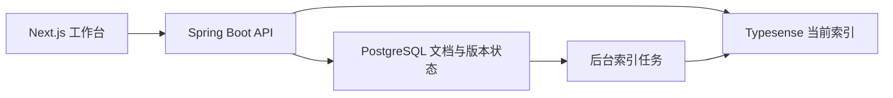

# 文档搜索索引在线迁移

> **立项设计。** 本 README 定义首版交付范围与验收条件。功能、测试结果和性能数据待实现后更新。

文档站需要改版搜索索引时，系统在后台构建新版本，旧版本继续提供搜索，用户仍可编辑文档。新版本准备好后，系统切换搜索流量。重建期间新增的文档、修改后的标题和已删除的文档都应该在切换后正确反映出来。

**首版唯一主亮点是带并发写入的索引重建与一致性切换。** 典型故障是重建照着旧快照导入时，有人删除了一篇公告，切换之后它又出现在搜索结果里。项目要解决的就是快照、增量变更和切换之间的衔接，并用自动化测试证明最后一笔写入也能进入正确的版本。

## 首版交付与规模

| 项目 | 首版范围 |
| --- | --- |
| 使用场景 | 一个文档库，支持文档新增、编辑、删除，以及按标题和正文搜索 |
| 迁移流程 | 将已有的分类字段升级为可筛选字段，以这次索引配置变更验证完整重建和切换流程 |
| 运行边界 | 一个 Spring Boot 服务实例和一个后台执行器，同一时间运行一项重建任务。一个 PostgreSQL 实例和一个 Typesense 实例 |
| 操作界面 | 一个 Next.js 工作台，包含文档搜索与编辑、发起重建、迁移进度和失败原因 |
| 验收负载 | 20,000 条测试文档。重建期间安排 300 次提交成功的增删改，每 200 ms 发起一次搜索探测。另以独立的小数据集完成 200 轮随机并发对账 |
| 交付物 | Docker Compose 运行环境、初始化样本、可重复验收脚本，以及带实际环境和结果的测试报告 |

测试负载是首版验收规模。正常重建时，搜索请求持续使用当前版本，写入继续提交到 PostgreSQL。搜索同步采用最终一致性，工作台显示当前待同步条数。切换时，新版本必须包含切换前已经提交的全部写入。切换后提交的写入继续进入同步流程。

## 技术栈与开源复用

| 层 | 选型 |
| --- | --- |
| Web | Next.js App Router、TypeScript、Tailwind CSS。复用已有 Next.js 项目的基础组件和样式习惯 |
| 服务端 | Java 21、Spring Boot、Spring MVC、Spring JDBC、Maven。数据库事务和锁用明确的 SQL 表达 |
| 数据 | PostgreSQL 保存文档、变更日志、任务和当前索引版本。Typesense 存放可重建的全文检索数据 |
| 运行与测试 | Docker Compose、JUnit 5、Testcontainers。核心验收连接真实 PostgreSQL 和 Typesense |

- **Typesense 引擎与 Java SDK**直接作为依赖使用，负责全文搜索、索引管理和文档读写。 [Typesense](https://github.com/typesense/typesense) · [Java SDK](https://github.com/typesense/typesense-java)
- **Spring Boot 搜索 API 示例**用于参考客户端接入、索引定义、搜索路由和批量导入。启动配置参考 MIT 许可的 Typesense 脚手架。 [Spring Boot 示例](https://typesense.org/docs/guide/spring-boot-search-api.html) · [create-typesense-app](https://github.com/typesense/create-typesense-app)
- **项目自行实现**写入事务、可重放变更日志、索引重建与切换、失败后重跑和独立对账脚本。实际复制进仓库的代码会保留来源和许可说明。

## 系统结构

所有浏览器操作都经过 Spring Boot。每次搜索在 `READ COMMITTED` 下用普通 `SELECT` 读取一次当前物理索引，释放数据库连接后再请求 Typesense。索引指针和最新提交序号保留在同一条控制记录。PostgreSQL 的普通查询可以读取已提交的版本，文档写入和切换持有的行锁只影响同一行的写入和加锁操作。这样搜索可以在切换事务提交前读旧索引，提交后发起的新搜索则读新索引。刚切完的旧索引继续保留，供已经开始的查询完成。 [PostgreSQL 行锁](https://www.postgresql.org/docs/current/explicit-locking.html) · [事务隔离](https://www.postgresql.org/docs/current/transaction-iso.html)

### 1. 文档与变更日志同事务提交

文档写入和索引切换使用同一条索引控制记录的行锁。文档新增、修改、删除先获得该锁，再更新文档、分配递增的变更序号、追加一条变更日志，最后一起提交。序号由同事务内更新的控制记录分配，便于按提交顺序重放。写入提交在一个文档库内串行排序，其成本通过写入延迟衡量。

新增和修改事件包含完整的索引字段，删除事件保留文档 ID。后台执行器每次只为同一物理索引发送一个修改请求，收到确认后才推进该索引的重放进度。索引数据写入和 Typesense 批量导入结果都要逐项检查。 [PostgreSQL 行锁](https://www.postgresql.org/docs/current/explicit-locking.html) · [Typesense 文档 API](https://typesense.org/docs/30.1/api/documents.html)

### 2. 固定快照，再重放增量

创建重建任务时，在 PostgreSQL 的同一个 `REPEATABLE READ` 事务里读取日志进度和文档数据，将这一时刻的内容保存为重建快照。事务提交后，从快照表分批导入新索引。全量导入完成，再按照序号重放快照之后提交的增删改。旧索引在此期间继续接收已提交的变更。 [PostgreSQL 事务隔离](https://www.postgresql.org/docs/current/transaction-iso.html)

### 3. 新索引追平后，才切换版本

全量导入完成且所有重放批次均已确认后，后台任务在一个短事务里锁定索引控制记录，检查**新索引已确认的最后一条变更序号**和**数据库已提交的最后一条变更序号**。两者一致时，更新当前版本和任务状态并提交。发现有一笔更新刚刚抢先提交时，释放锁，继续重放后再试。发给 Typesense 的网络请求在事务之外执行。

切换事务和文档写入争用同一条锁。写入先提交，就会纳入切换条件。切换先提交，下一笔写入则由新版本继续同步。持续写入超过重放能力时，重建在达到重试上限后结束并显示原因，当前版本继续服务。

### 4. 失败处理与重跑

**主线保护。** 重建状态和已确认进度存入 PostgreSQL。只有全量导入成功、增量已追平且批次均已确认的版本可以切换。某批失败或响应不明时，任务保留出错阶段和最后确认的序号，搜索继续使用当前版本。操作员重新发起重建时，使用新的物理索引名。上一次超时的请求即使晚到，也只会影响上一次的物理索引。活跃索引遇到结果不明的写入时，暂停推进该版本的同步进度。操作员可从 PostgreSQL 重新构建索引。

**恢复增强。** 主线验收完成后，再做持久化批次发送记录、判定重启时的未确认批次、自动恢复，以及活跃索引可能落后的状态提示。重启时旧的未确认索引保持隔离，恢复使用新物理版本。这组能力随对应测试结果单独发布。

## 验收标准

切换对照入口：`python tests/baseline/stale_snapshot.py`（Python 3、Docker Compose）。已用 PostgreSQL 17 Alpine 与 Typesense 29.0 跑通两组用例：快照后删除公告 42，直接切换会搜到 42、43；仅确认到快照序号时切换被拒绝，重放并确认删除后切换只搜到 43。当前由测试驱动重放，尚未验收后台执行器或持续并发写入。

写入事务入口：`python tests/baseline/test_document_changes.py`。已在 PostgreSQL 17 Alpine 上验证新增、修改、删除及重复删除，并通过变更日志约束注入失败，确认文档、日志和已提交序号同时回滚。此项只验证数据库写入，不覆盖搜索切换。

### 主线验收

| 场景 | 可复现操作 | 通过条件 |
| --- | --- | --- |
| 基线对照 | 对同样的输入执行「导入快照后直接切换」。快照保存后删除一篇文档 | 基线能稳定复现已删除文档重新出现，正式流程通过相同回归用例 |
| 并发增删改 | 在 20,000 条文档的重建中提交 300 次写入，按脚本确定操作落在重建期间 | 切换完成并追平后，从 Typesense 导出新版本，对比 PostgreSQL 的文档 ID 集合和索引字段。多出、缺失、内容不符均为 0，分类筛选结果符合预期 |
| 最后一笔写入 | 用同步点安排一笔写入在切换检查前提交，再测切换先提交的时序 | 前一种继续追平后再切。后一种由新版本消费写入。两种最终结果均通过对账 |
| 读写隔离 | 切换事务锁定控制记录并写入新版本指针，在提交前从另一个连接发起搜索 | 搜索在锁仍持有时完成并使用旧版本。提交后发起的新搜索读取新版本 |
| 搜索连续性 | 正常重建期间每 200 ms 发送搜索请求，记录返回的版本和延迟 | 搜索探测无失败，观测到版本切换，并记录读指针 P95、端到端搜索 P95、写入 P95 和重建耗时 |
| 事务回滚 | 在文档更新之后、变更日志落库之前制造异常 | 文档内容、变更日志和已提交序号均回到操作前 |
| 切换保护 | 给新索引注入一个失败或未确认的批次 | 版本指针仍指向原索引，进度停在最后一个已确认的批次 |
| 随机并发对账 | 固定 200 个随机种子。每轮从 100 条文档开始，4 个并发任务在重建期间执行共 60 次增删改，包含对同一 ID 的反复修改和删除后重建 | 每轮停止写入并等索引追平，从真实 Typesense 导出结果并与 PostgreSQL 对账。200 轮均无多出、缺失或内容不符 |

定序用例用同步点控制关键并发时序。随机测试保留种子、生成的操作序列、数据库实际提交序号和重建阶段记录。种子可重现输入，实际并发时序以运行记录为准。出现差异时，将对应时序缩成一条可复现的回归用例。功能用例、测试环境、负载、通过情况和时延数据随首版记录。

### 故障恢复与单独测量

| 项目 | 测试方法与结果口径 |
| --- | --- |
| 导入失败与人工重跑 | 注入批量导入部分失败，验证状态和失败原因。使用新物理版本重跑，完成切换并通过全量对账 |
| 随机故障恢复 | 在增量重放期间，从固定种子生成的批次位置终止后台进程，覆盖 Typesense 已收到请求但确认尚未落库的窗口。重启后核对当前版本与恢复决策，再用新物理版本重建并完成对账 |
| 10 万条重建耗时 | 额外跑一次完整重建，记录机器配置、数据大小、批大小、端到端耗时和分阶段耗时。作为一次独立的规模测量。首版并发一致性仍以 20,000 条场景和 200 轮随机对账验收。 [Typesense 性能测试口径](https://typesense.org/docs/overview/benchmarks.html) |

如果前两次开发时段结束时，基础链路或最小故障复现仍卡住，先定位是 Java 接入问题还是迁移方案问题，再重估排期。首版时间优先投给后端正确性和可验证交付，界面先保留完成操作和读懂结果所需的内容。
